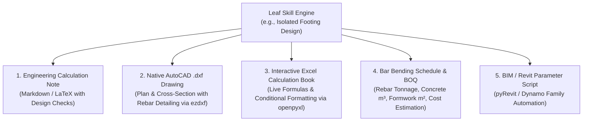

# Brainstorming & Architecture
# Pure Hierarchical Engineering Design Tree & Multi-Deliverable AI System

---

## 1. The Multi-Deliverable Engineering Package
A professional engineering design is not just a block of text. The system outputs a complete, industry-standard engineering package:

---

## 2. Shared Exporter Subsystem (`core/exporters/`)
To maintain DRY principles, reusable generators reside in `core/exporters/`:
- `core/exporters/dxf_writer.py`: Standardizes AutoCAD drawing creation, drawing scales, title blocks, and standard layers:
  - `S-CONC`: Concrete outline (Cyan / White).
  - `S-REBAR`: Reinforcement bars and hooks (Red / Yellow).
  - `S-DIMS`: Engineering dimensions (Green).
  - `S-TEXT`: Annotations and callout tags (Yellow / White).
- `core/exporters/excel_writer.py`: Standardizes corporate styling, header palettes, font sizing, and live cell formulas.
- `core/exporters/boq_engine.py`: Computes volume of concrete, formwork area, rebar weight in metric tons, and unit rates.
